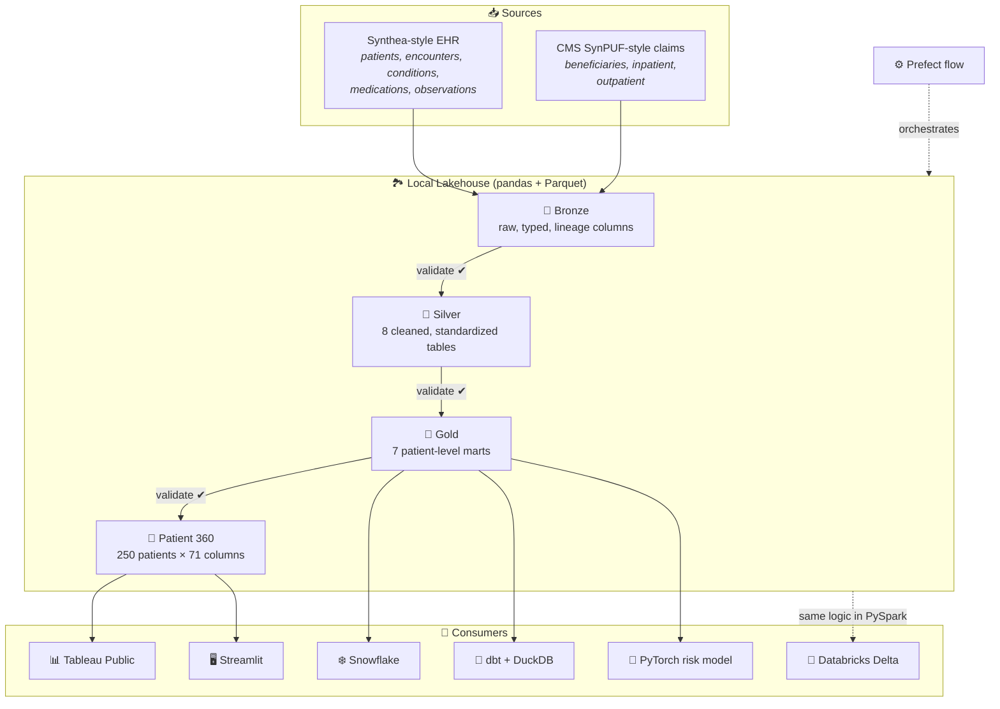

<div align="center">

# 🏥 Healthcare Claims & EHR Lakehouse

### From scattered clinical records and insurance claims to one view of each patient

*A full medallion lakehouse joining synthetic EHR and Medicare-style claims data into Patient 360 analytics, dashboards, a cloud warehouse, dbt models and a PyTorch risk model.*


**[📊 View the live Tableau Public dashboard](https://public.tableau.com/views/HealthcareClaimsEHRLakehouseReport/HealthcarePatient360AnalyticsDashboard)**

[The problem](#-the-problem) •
[Architecture](#%EF%B8%8F-architecture) •
[Quick start](#-quick-start) •
[Layers](#-the-medallion-layers) •
[Patient 360](#-patient-360) •
[Analytics stack](#-the-analytics-stack) •
[Real-world data](#-real-world-public-data-track)

</div>

---

## 🩺 The problem

A patient's story is split across two worlds.

- The **EHR** (electronic health record) knows *what happened clinically*: diagnoses, lab results, medications, encounters.
- **Claims** know *what was paid for*: inpatient stays, outpatient visits, reimbursements.

Neither one alone answers the questions care managers ask: *Which patients carry the heaviest chronic condition burden? Who uses the most care? Who should a nurse call first?*

This project brings the two worlds together in a layered lakehouse and produces a **Patient 360**: one row per patient, 71 columns, ready for dashboards, a warehouse and machine learning.

## ✨ What's inside

| | |
|---|---|
| 🥉🥈🥇 **Medallion pipeline** | Raw → Bronze → Silver → Gold, with a validation gate after every layer |
| 👤 **Patient 360 mart** | Demographics, utilization, conditions, cost and care-management priority in one table |
| ⚙️ **Orchestration** | One-command local runner plus a Prefect flow with step-level logging |
| 🧱 **dbt models** | Staging → intermediate → marts on DuckDB, with schema tests |
| ❄️ **Snowflake** | Scripts to create warehouse objects, load Gold Parquet and validate row counts |
| 🧪 **Databricks** | Notebook scripts mapping every layer to Delta Lake tables in PySpark |
| 🧠 **PyTorch** | Feed-forward patient risk classifier trained on Gold features |
| 📊 **Dashboards** | Streamlit app (3 views) and a published Tableau Public dashboard |
| 🌍 **Real-world track** | MIMIC-IV Demo and CMS Medicare PUF ingested, profiled and validated separately |
| 📝 **Reports** | Committed JSON and Markdown profiling reports, so results can be reviewed without running anything |

---

## 🏛️ Architecture



A layer-by-layer walkthrough is in **[docs/architecture.md](docs/architecture.md)**.

---

## 🚀 Quick start

```bash
git clone https://github.com/CapCoder0/healthcare-claims-ehr-lakehouse.git
cd healthcare-claims-ehr-lakehouse

python -m venv .venv && source .venv/bin/activate
pip install -r requirements.txt
```

### 1. Generate synthetic raw data (250 linked patients)

```bash
python scripts/generate_data/create_sample_raw_data.py
```

### 2. Run the whole pipeline

```bash
# Option A: Prefect flow (medallion pipeline → Patient 360 → profiling → Tableau exports)
python scripts/orchestration/run_prefect_pipeline.py

# Option B: medallion layers only, fail-fast
python scripts/run_local_pipeline.py
```

### 3. Explore

```bash
streamlit run streamlit_app/app.py
```

<details>
<summary><b>▶ Run each step by hand</b></summary>

```bash
# Bronze
python scripts/bronze/build_bronze_tables.py
python scripts/bronze/validate_bronze_tables.py
# Silver
python scripts/silver/build_silver_tables.py
python scripts/silver/validate_silver_tables.py
# Gold
python scripts/gold/build_gold_tables.py
python scripts/gold/validate_gold_tables.py
python scripts/gold/profile_gold_tables.py
# Patient 360
python scripts/gold/build_patient_360.py
python scripts/gold/profile_patient_360.py
# BI exports
python scripts/exports/create_tableau_exports.py
# Machine learning
python scripts/ml/create_ml_dataset.py
python scripts/ml/train_patient_risk_model.py
python scripts/ml/evaluate_patient_risk_model.py
```

</details>

---

## 🥇 The medallion layers

| Layer | What happens | Output |
|---|---|---|
| 🥉 **Bronze** | Raw CSVs land as Parquet with lineage columns (`bronze_source_system`, `bronze_source_file`) and are checked for rows and lineage columns | `data/bronze/` |
| 🥈 **Silver** | Types fixed, dates parsed, codes standardized, required columns checked | `silver_patients`, `silver_encounters`, `silver_conditions`, `silver_medications`, `silver_observations`, `silver_claims_beneficiaries`, `silver_inpatient_claims`, `silver_outpatient_claims` |
| 🥇 **Gold** | EHR and claims linked through a patient crosswalk, then aggregated per patient | `gold_patient_crosswalk`, `gold_patient_master`, `gold_utilization_summary`, `gold_condition_summary`, `gold_medication_summary`, `gold_observation_summary`, `gold_patient_risk_features` |
| 👤 **Patient 360** | All Gold marts joined into one business-facing row per patient, plus derived segments | `gold_patient_360.parquet` |

**Fail-fast by design.** If Silver validation fails, Gold never runs, so bad data can't reach a dashboard.

---

## 👤 Patient 360

The flagship table. One row per patient combines everything a care manager needs:

| Field group | Examples |
|---|---|
| **Identity** | `ehr_patient_id`, `claim_beneficiary_id`, `crosswalk_method` |
| **Demographics** | age, `age_band`, gender, race, ethnicity, city, county, state |
| **Utilization** | encounters (ER / outpatient / ambulatory), inpatient days, claim counts |
| **Cost** | encounter cost, claims paid, reimbursements, medication cost |
| **Clinical burden** | 11 chronic condition flags (CHF, diabetes, COPD, CKD, cancer, stroke…), condition counts |
| **Derived segments** | `utilization_segment`, `cost_segment`, `care_management_priority` |

### What the current build shows

| Care management priority | Patients |
|---|---|
| 🔴 High priority | **94** |
| 🟠 Medium priority | **70** |
| 🟢 Low priority | **86** |

**250** patients · **71** columns · **0** duplicate keys · **2,798** utilization events · **$14.8M** total cost proxy

<sub>Source: <a href="reports/gold/patient_360_profile_report.md">reports/gold/patient_360_profile_report.md</a></sub>

---

## 🧰 The analytics stack

### 🧱 dbt (on DuckDB)

```
models/
├── staging/        stg_gold_patient_master, stg_gold_utilization_summary,
│                   stg_gold_condition_summary, stg_gold_patient_risk_features   (views)
├── intermediate/   int_patient_conditions, int_patient_utilization
└── marts/          mart_patient_risk_features
```

The staging models read the Gold Parquet files directly with DuckDB's `read_parquet`. Add a `healthcare_claims` profile to `~/.dbt/profiles.yml`:

```yaml
healthcare_claims:
  target: dev
  outputs:
    dev:
      type: duckdb
      path: ../../data/dbt/healthcare_claims.duckdb
```

```bash
cd dbt/healthcare_claims
dbt build      # run models + schema tests
```

### ❄️ Snowflake

```bash
export SNOWFLAKE_ACCOUNT=... SNOWFLAKE_USER=... SNOWFLAKE_PASSWORD=... SNOWFLAKE_ROLE=...
# optional: SNOWFLAKE_WAREHOUSE, SNOWFLAKE_DATABASE, SNOWFLAKE_SCHEMA, SNOWFLAKE_STAGE

# 1. run scripts/snowflake/create_snowflake_objects.sql in a Snowflake worksheet
python scripts/snowflake/load_gold_to_snowflake.py
python scripts/snowflake/validate_snowflake_tables.py
```

Credentials come from environment variables only. Nothing is stored in the repo.

### 🧪 Databricks Delta Lake

`notebooks/databricks/01_bronze_delta.py` → `02_silver_delta.py` → `03_gold_delta.py` repeat the local pandas logic in PySpark and write Delta tables. Import them into a Databricks workspace to run them. See [docs/databricks_delta_lake.md](docs/databricks_delta_lake.md).

### 🧠 PyTorch patient risk model

```
input (patient features) → Linear(32) → ReLU → Linear(16) → ReLU → Linear(1) → logit
```

A baseline binary classifier trained for 100 epochs on Gold risk features. With only 250 synthetic patients, the metrics in `reports/ml/` **show that the workflow runs end to end. They don't measure clinical accuracy.** Details: [docs/pytorch_model.md](docs/pytorch_model.md).

### 📊 Dashboards

- **Tableau Public:** [Healthcare Patient 360 Analytics Dashboard](https://public.tableau.com/views/HealthcareClaimsEHRLakehouseReport/HealthcarePatient360AnalyticsDashboard). The workbook is in `tableau/`.
- **Streamlit:** three tabs: *Synthetic Lakehouse Dashboard*, *Patient 360* and *Real-World Public Data Extension*.

---

## 🌍 Real-world public data track

Besides the synthetic pipeline, the project ingests two **real public datasets**:

| Dataset | What it is |
|---|---|
| [MIMIC-IV Clinical Database Demo](https://physionet.org/content/mimic-iv-demo/2.2/) | De-identified EHR data for 100 patients from Beth Israel Deaconess Medical Center |
| CMS Basic Stand Alone Medicare Claims PUF | Public, aggregated Medicare claims data |

```bash
python scripts/real_world/ingest_mimic_demo.py
python scripts/real_world/ingest_cms_claims_puf.py
python scripts/real_world/profile_mimic_demo.py
python scripts/real_world/profile_cms_claims_puf.py
python scripts/real_world/validate_real_world_bronze.py
```

> 🧭 **A deliberate design decision:** these two datasets are **never joined** into Patient 360. They come from different populations and different de-identification processes, so linking them would fabricate patient records that don't exist. They're ingested, profiled and validated as separate tracks. See [docs/real_world_data_sources.md](docs/real_world_data_sources.md).

Download the raw files yourself (see the doc above). They are git-ignored and not redistributed here.

---

## 📁 Project structure

```
healthcare-claims-ehr-lakehouse/
├── data/                   # raw / bronze / silver / gold (git-ignored), ml + tableau exports
├── scripts/
│   ├── generate_data/      # synthetic raw data generator
│   ├── inspect/            # raw file inspection + schema summary
│   ├── bronze/ silver/ gold/   # build + validate + profile per layer
│   ├── exports/            # Tableau-ready CSVs
│   ├── ml/                 # dataset, training, evaluation
│   ├── orchestration/      # Prefect flow
│   ├── snowflake/          # DDL, loader, validator
│   ├── real_world/         # MIMIC-IV + CMS PUF ingestion
│   └── run_local_pipeline.py
├── dbt/healthcare_claims/  # dbt project (staging → intermediate → marts)
├── notebooks/databricks/   # Delta Lake notebooks
├── streamlit_app/          # Streamlit dashboard
├── tableau/                # Tableau workbook
├── reports/                # committed profiling + validation reports
└── docs/                   # in-depth docs for every layer
```

## 📚 Documentation

| Topic | Doc |
|---|---|
| Architecture | [docs/architecture.md](docs/architecture.md) |
| Data sources | [docs/project_plan.md](docs/project_plan.md), [docs/data_acquisition.md](docs/data_acquisition.md) |
| Bronze / Silver / Gold | [bronze](docs/bronze_layer.md) · [silver](docs/silver_layer.md) · [gold](docs/gold_layer.md) |
| Patient 360 | [docs/patient_360.md](docs/patient_360.md) |
| Orchestration | [local runner](docs/local_pipeline_runner.md) · [Prefect](docs/prefect_orchestration.md) |
| Databricks | [docs/databricks_delta_lake.md](docs/databricks_delta_lake.md) |
| Machine learning | [features](docs/ml_feature_engineering.md) · [PyTorch model](docs/pytorch_model.md) |
| BI | [Tableau exports](docs/tableau_exports.md) · [dashboard plan](docs/tableau_public_dashboard_plan.md) |
| Real-world data | [docs/real_world_data_sources.md](docs/real_world_data_sources.md) |

---

## ⚠️ Disclaimer

The core pipeline runs on **synthetic data**. No real patient is represented in the linked EHR and claims records. Results here demonstrate data engineering and analytics practice. Don't use them for clinical or policy decisions. Public datasets are used under their own licenses and terms.

<div align="center">

**Built to show that good healthcare data engineering cares about patients as much as pipelines.**

</div>
