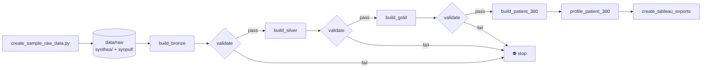
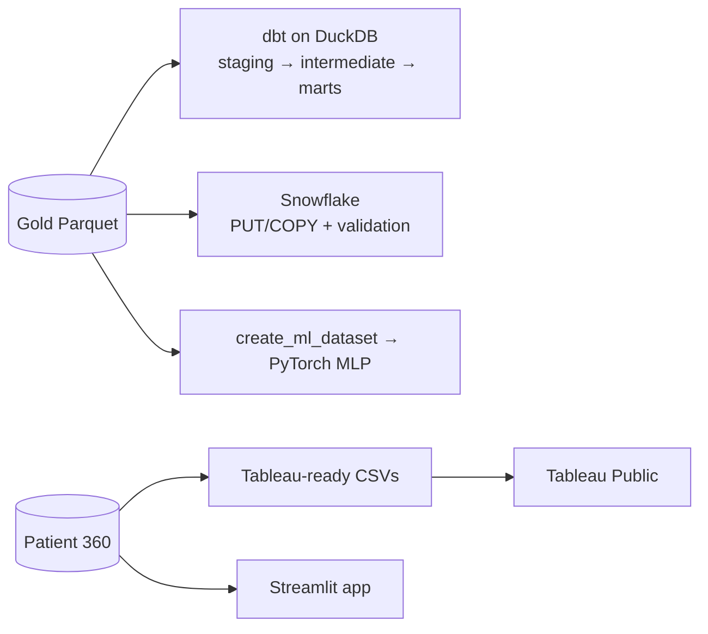
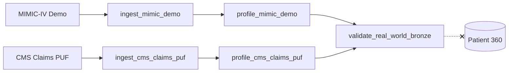

# Architecture

This document explains how data moves through the Healthcare Claims & EHR Lakehouse, why each layer exists, and how the downstream tools connect.

---

## 1. Design goals

1. **Link clinical and financial views of the same patient.** EHR data describes care and claims data describes payment. Gold joins them.
2. **Never build on bad data.** Every layer has a validation gate, and the pipeline stops at the first failure.
3. **Keep it reproducible.** The synthetic generator uses a fixed seed (`RANDOM_SEED = 42`) and 250 patients, so every run gives the same output.
4. **Stay portable.** The same medallion logic runs locally in pandas/Parquet and on Databricks with PySpark/Delta.
5. **Be honest with data.** Datasets that can't be linked (MIMIC-IV Demo and CMS PUF) are kept separate.

---

## 2. End-to-end flow

| Runner | Scope |
|---|---|
| `scripts/run_local_pipeline.py` | Bronze → Silver → Gold, each built and validated, fail-fast |
| `scripts/orchestration/run_prefect_pipeline.py` | Prefect flow `healthcare-claims-ehr-local-lakehouse-pipeline`: the local pipeline, then Patient 360 build, profiling and Tableau exports |

---

## 3. Layers

### 🥉 Bronze: land it as-is

- **Input:** raw Synthea-style EHR CSVs and SynPUF-style claims CSVs
- **Work:** read, apply minimal typing, write Parquet, add lineage columns `bronze_source_system` and `bronze_source_file`
- **Validation:** each file is readable, has rows, and carries the Bronze lineage columns
- **Why:** gives a replayable copy of the source that downstream layers can always rebuild from

### 🥈 Silver: make it trustworthy

| Table | Grain |
|---|---|
| `silver_patients` | one row per EHR patient |
| `silver_encounters` | one row per clinical encounter |
| `silver_conditions` | one row per diagnosis |
| `silver_medications` | one row per medication record |
| `silver_observations` | one row per lab or vital observation |
| `silver_claims_beneficiaries` | one row per Medicare beneficiary |
| `silver_inpatient_claims` | one row per inpatient claim |
| `silver_outpatient_claims` | one row per outpatient claim |

- **Work:** standardize column names, parse dates (ISO and `YYYYMMDD` claim dates), cast numerics, normalize codes
- **Validation:** each table exists, has rows, and contains its required columns

### 🥇 Gold: answer business questions

| Table | Purpose |
|---|---|
| `gold_patient_crosswalk` | Links `ehr_patient_id` ↔ `claim_beneficiary_id` (synthetic, deterministic match) |
| `gold_patient_master` | Unified demographics |
| `gold_utilization_summary` | Encounters and claims per patient, by type |
| `gold_condition_summary` | 11 chronic-condition flags and condition counts |
| `gold_medication_summary` | Medication counts, costs and dispenses |
| `gold_observation_summary` | Observation counts and value statistics |
| `gold_patient_risk_features` | Wide ML feature table, high-cost and care-management flags |

### 👤 Patient 360: the executive view

Joins all Gold marts on `(ehr_patient_id, claim_beneficiary_id, crosswalk_method)` and derives:

- `age_band`: `0-17`, `18-34`, `35-49`, `50-64`, `65+`
- `patient_360_total_utilization_events`: total of all utilization counts
- `patient_360_total_cost_proxy`: total of all cost, paid and reimbursement fields
- `patient_360_condition_burden`: clinical burden score
- `utilization_segment`, `cost_segment`, `care_management_priority`: Low / Medium / High

Output: **250 rows × 71 columns** in `data/gold/gold_patient_360.parquet`.

---

## 4. Downstream consumers

| Consumer | Key files | Notes |
|---|---|---|
| **dbt** | `dbt/healthcare_claims/` | Staging models are views over `read_parquet()`. Schema tests are in `schema.yml` |
| **Snowflake** | `scripts/snowflake/` | DDL plus Python loader and validator. Credentials come from env vars only |
| **PyTorch** | `scripts/ml/` | MLP 32 → 16 → 1, BCE loss, 100 epochs. Reports are written to `reports/ml/` |
| **Tableau** | `scripts/exports/`, `tableau/` | Five CSV exports and a published workbook |
| **Streamlit** | `streamlit_app/app.py` | Tabs: Synthetic Lakehouse, Patient 360, Real-World Extension |
| **Databricks** | `notebooks/databricks/` | Bronze, Silver and Gold as Delta tables in PySpark |

---

## 5. Real-world public data track

The dashed ✗ is intentional. These sources aren't linkable at the patient level, so they never feed Patient 360. They demonstrate ingestion, profiling and validation of real public healthcare data on their own terms.

---

## 6. Reports as evidence

Every stage writes machine-readable (JSON) and human-readable (Markdown) reports to `reports/`. Reviewers can check row counts, schemas, segment distributions and model metrics without running the pipeline.
